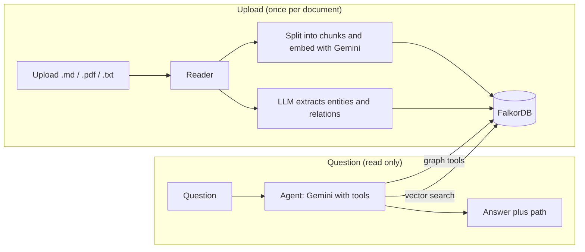

# Decision Tracker

**Ask why a decision was made, and see the path the agent followed to answer.**

Decision Tracker is an agent that reads a company's documents (ADRs, postmortems, meeting notes, ownership lists), builds a knowledge graph of people, teams, systems, decisions and incidents in **FalkorDB**, and answers questions by walking that graph. Every answer comes with the path behind it.

Built for **Graph Hacks: Context for AI Agents**, Track 3 (Company Brain).

## The problem

Company knowledge is scattered across documents. The hard questions are about connections:

- *Why did we stop using Redis for sessions?*
- *Who should I talk to about the billing service?*
- *What decisions affect the auth service, and are any outdated?*

No single document answers these. A plain vector search finds text that sounds similar, but it cannot follow "this incident triggered that decision, which a later decision replaced."

## How it works



**One database holds everything.** FalkorDB stores the knowledge graph and also the text chunks with their embeddings (using its built-in vector index). Chunks link to the documents they came from, so the agent can move from text to entities and back.

### The graph

Nodes: `Person`, `Team`, `System`, `Decision`, `Incident`, `Document`, `Chunk`

| Relationship | From to To |
|---|---|
| `MEMBER_OF` | Person to Team |
| `OWNS`, `REVIEWS` | Team to System |
| `DEPENDS_ON` | System to System |
| `DECIDED` | Person to Decision |
| `TRIGGERED` | Incident to Decision |
| `AFFECTS` | Decision or Incident to System |
| `SUPERSEDES` | Decision to Decision |
| `MENTIONED_IN` | any entity to Document |
| `PART_OF` | Chunk to Document |

Extraction output is validated against a fixed schema in code before anything is written, so the LLM cannot create unknown labels or invalid connections. Entities are merged on a normalized name, and the names already in the graph are shown to the LLM so the same incident or decision keeps one name across documents.

### The agent

The LLM decides which tool to call and in what order:

| Tool | Answers |
|---|---|
| `traceDecision` | Why was this decided, by whom, what triggered it, what does it affect |
| `decisionsAffecting` | Every decision on a system, and whether another decision superseded it |
| `whoKnowsAbout` | Owning team, its members, reviewers, and people who decided things about a system |
| `searchDocuments` | Vector search over the document text, with a similarity cutoff |

Each tool records the relationships it followed. The API returns the answer together with that path, and the UI shows it under every answer.

"Outdated" is not stored anywhere. It is derived from the graph: a decision is outdated if another decision `SUPERSEDES` it.

## Demo

Sample documents for a fictional company, **Northwind Pay**, are in `sample-docs/`.

1. **"Why did we stop using Redis for sessions?"** The agent finds the decision, follows `TRIGGERED` back to the March outage, names who decided it, then pulls the original text.
2. **"Who should I talk to about the billing service?"** It finds the owning team and its members.
3. **"What decisions affect the auth service, and are any outdated?"** It lists the decisions and flags the static-token decision as replaced by the short-lived token design, using the `SUPERSEDES` relationship.

## Tech stack

- Java 21, Spring Boot 4.1.1, Spring AI 2.0.1
- Gemini for chat and tool calling, `gemini-embedding-001` for embeddings (3072 dimensions)
- FalkorDB (graph and vector index) through the `jfalkordb` client
- React, Tailwind CSS v4, Vite

## Run it

**Prerequisites:** Java 21, Maven, Docker, Node 18+, a Gemini API key.

```bash
# 1. Start FalkorDB (database on 6379, browser UI on 3000)
docker compose up -d

# 2. Start the backend (set your Gemini API key as configured in application.properties)
./mvnw spring-boot:run

# 3. Start the frontend
cd frontend
npm install
npm run dev
```

Open `http://localhost:5173`, click the `+` button and upload the files in `sample-docs/` one at a time (wait a few seconds between uploads, since each runs extraction), then ask the three questions above.

You can inspect the graph in the FalkorDB Browser at `http://localhost:3000` (host `localhost`, port `6379`, graph `company`).

## Project structure

```
src/main/java/com/ai/decision_tracker
  controller/   upload and /ask endpoints
  service/      file reading (PDF, Markdown, text) and ingestion
  graph/        GraphService, ChunkStoreService (vector index), GraphWriter
  extraction/   LLM extraction prompt, output record, graph schema whitelist
  agent/        graph tools, path recorder, agent service
frontend/       React chat UI with the path display
sample-docs/    five Northwind Pay documents
```

## Notes and limitations

- Ingestion runs in the background, so the UI cannot yet show when indexing has finished.
- Keyword matching in the graph tools is simple; the LLM picks the keyword.
- Extraction quality depends on the prompt. Action items and follow-ups are deliberately excluded from decisions.
- The conversation is not stored per user yet.

## What's next

A decisions list view with Active and Superseded badges, decision dates and reasons, per-user memory graphs, and ingestion status.